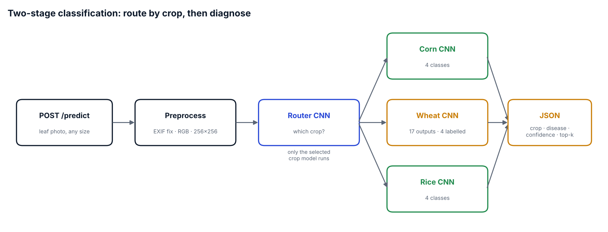
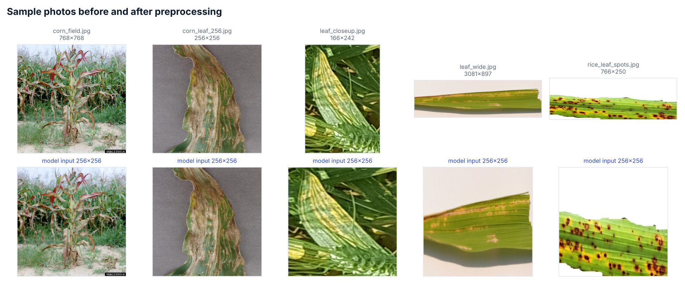

# Crop Disease Prediction

[](https://github.com/vishavjit-singh/Crop_Disease_Prediction/actions/workflows/ci.yml)


A REST API that takes a photo of a crop leaf and returns **which crop it is** (corn, wheat or rice) and **which disease it shows**, with confidence scores. It uses a two-stage design. A router CNN identifies the crop first, then only that crop's specialist CNN runs. Each disease model can then focus on the visual differences within one plant.



## Classes

| Crop | Disease classes |
|---|---|
| Corn | Common Rust · Gray Leaf Spot · Healthy · Northern Leaf Blight |
| Wheat | Healthy · Yellow Rust · Red Rust · Green Rust |
| Rice | Brown Spot · Healthy · Leaf Blast · Neck Blast |

All four models are small Keras CNNs: 6 conv/pool blocks, a dense layer of 64 units, and a softmax output. Each one has its own resize and rescale layers.

## Quickstart

```bash
git clone https://github.com/vishavjit-singh/Crop_Disease_Prediction.git
cd Crop_Disease_Prediction
pip install -r requirements.txt
uvicorn app.main:app --port 8001
```

Interactive docs are served at **http://localhost:8001/docs**. To call the API from the command line:

```bash
curl -F "file=@assets/rice_leaf_spots.jpg" http://localhost:8001/predict
```

```json
{
  "crop": "Rice",
  "crop_confidence": 0.97,
  "disease": "Rice Brown Spot",
  "confidence": 0.91,
  "top_k": [
    {"disease": "Rice Brown Spot", "probability": 0.91},
    {"disease": "Rice Leaf Blast", "probability": 0.06},
    {"disease": "Rice Healthy", "probability": 0.02}
  ],
  "labelled": true
}
```

*The numbers above show the response format only. Real scores depend on the image.*

With Docker:

```bash
docker build -t crop-disease-api .
docker run -p 8001:8001 crop-disease-api
```

### Endpoints

| Method | Path | Description |
|---|---|---|
| `POST` | `/predict?top_k=3` | Multipart image upload → crop, disease, confidences, top-k |
| `GET` | `/labels` | Crops and disease classes the models know |
| `GET` | `/health` | Liveness, and whether the models are loaded |

The API returns clear errors for bad input. A non-image content type gets `415`, an unreadable or empty file gets `400`, and an upload over `MAX_UPLOAD_MB` (default 10) gets `413`.

## Preprocessing

The saved models only accept a fixed 256×256 RGB input. The service converts any upload to that shape: it corrects EXIF rotation, converts grayscale, palette or RGBA images to RGB, and resizes to 256×256. Pixel scaling is left to the models' own `Rescaling(1/255)` layer.



## What changed in v2

| v1 | v2 |
|---|---|
| Uploads passed to the model at their original size, so most real photos failed with a shape error | Every image is resized to the 256×256 input the models expect |
| PNGs with transparency or grayscale images broke the 3-channel input | Converted to RGB, with EXIF orientation applied |
| Wheat model outputs 17 classes but only 4 names were defined, so 13 of its outputs raised `IndexError` | Handled. Such predictions come back marked `"labelled": false` instead of crashing |
| Label typos ("White Yellow Rus") | Corrected names, kept in [`app/labels.json`](app/labels.json) |
| Models loaded at import time, no validation, no tests | Loaded once at startup, input checks, `/health`, `/labels`, top-k output |
| 70-line `requirements.txt` pinning CUDA wheels (fails on CPU machines and macOS) | 6 direct dependencies |
| Empty README | This document, plus Docker, CI and tests |

## Testing

```bash
pip install -r requirements-dev.txt
pytest -q
```

- **Unit tests** cover preprocessing for any size or mode, crop routing, top-k ordering and unlabelled outputs. They use fake models, so they run in milliseconds.
- **API tests** cover status codes and the response schema through FastAPI's `TestClient`.
- **Real-model tests** load the four shipped `.h5` models and run them on every photo in `assets/`. These need TensorFlow installed and run on every push in CI.

## Project structure

```
├── app/
│   ├── main.py          # FastAPI app
│   ├── inference.py     # preprocessing + two-stage classifier
│   └── labels.json      # crop order, class names, model files
├── model/               # router + per-crop Keras models (.h5)
├── assets/              # sample leaf photos
├── scripts/make_figures.py
├── tests/
├── Dockerfile
└── .github/workflows/ci.yml
```

## Known limitations and next steps

- **Wheat model labels.** The shipped `wheat.h5` has 17 output units, but only 4 class names are known. The model should be retrained on the 4 wheat classes, or its full label list recovered.
- The training notebook and evaluation metrics are not in this repo, so no accuracy figures are claimed here. Next step: add the training pipeline with a held-out test set and a confusion matrix.
- Photos of a whole field (like `assets/corn_field.jpg`) are a different distribution from close-up leaf images. A leaf detector before classification would improve those cases.

Sample image credit: `assets/corn_field.jpg` is from Bugwood.org (image UGA1235014).

## Author

**Vishavjit Singh Saini**, Data Engineer · [GitHub](https://github.com/vishavjit-singh) · [LinkedIn](https://www.linkedin.com/in/vishavjit-singh-7011211ab/)

## License

[MIT](LICENSE)
